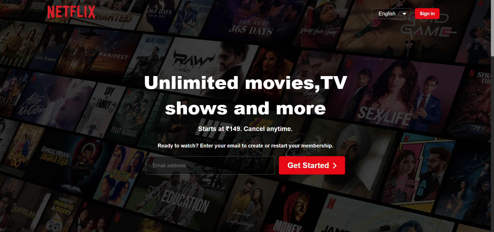
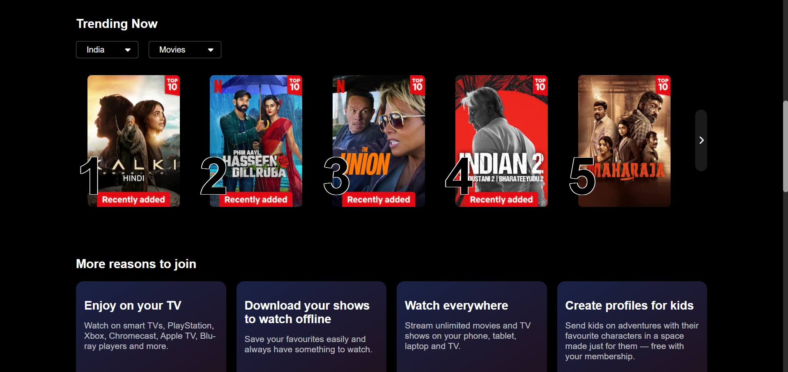
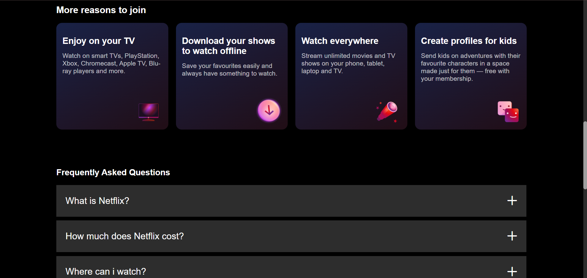
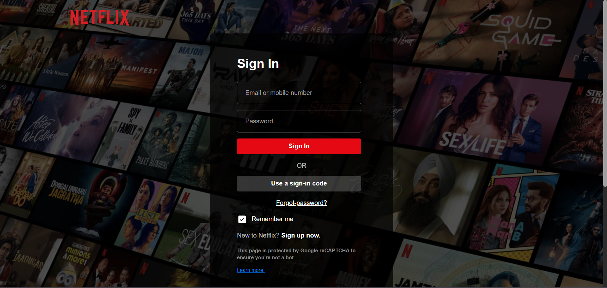

# 🎬 Netflix Website Clone

A **Netflix Website Clone** built using **HTML, CSS, and JavaScript**, showcasing responsive design and interactive UI components.  

This project was created as part of my personal coding challenge to replicate Netflix’s clean and dynamic interface.  
Now **fully responsive** and compatible across all devices 📱💻.

---

## 📸 Screenshots

| 🏠 Home Section | 🎬 Trending Movies Section |
|------------|------------|
|  |  |

| ⭐ Reasons To Join Section | 🔐 Sign In Page |
|------------|------------|
|  |  |

---

## 🚀 Features

| Feature | Description |
|:---|:---|
| **Header** | Includes the Netflix logo, navigation menu, and search bar. |
| **Hero Section** | Features a large promotional banner with a background image, tagline, and call-to-action button. |
| **Content Sections** | Showcases multiple categories of movie and TV show previews. |
| **FAQ Section** | Provides expandable and collapsible frequently asked questions using JavaScript. |
| **Font Awesome Integration** | Adds icons to enhance navigation and the overall user interface. |
| **Fully Responsive Design** | Adapts seamlessly to desktop, tablet, and mobile screen sizes. |

---

## 🛠️ Technologies Used

| Technology | Purpose |
|:---|:---|
| **HTML5** | Defines the structure and content of the website. |
| **CSS3** | Handles styling, animations, and responsive layouts. |
| **JavaScript (Vanilla JS)** | Powers FAQ expand/collapse functionality and UI interactivity. |
| **Font Awesome** | Provides icons for navigation and visual enhancement. |

---

## 🎯 How to Run the Project

1️⃣ Clone the repository:
```bash
  git clone https://github.com/TonyStark-19/Netflix-website-clone.git
```

2️⃣ Open the project folder:
```bash
  cd Netflix-website-clone
```

3️⃣ Open the `index.html` file in your browser.

---

## 🌟 Acknowledgments

| Source | Contribution |
|:---|:---|
| [**Netflix**](https://www.netflix.com) | Served as the primary inspiration for the website's design, layout, and streaming interface. |
| **Modern Web Design Practices** | Inspired the use of responsive layouts, clean UI, and user-friendly design principles. |

---

⭐ If you like this project, don’t forget to star the repository!